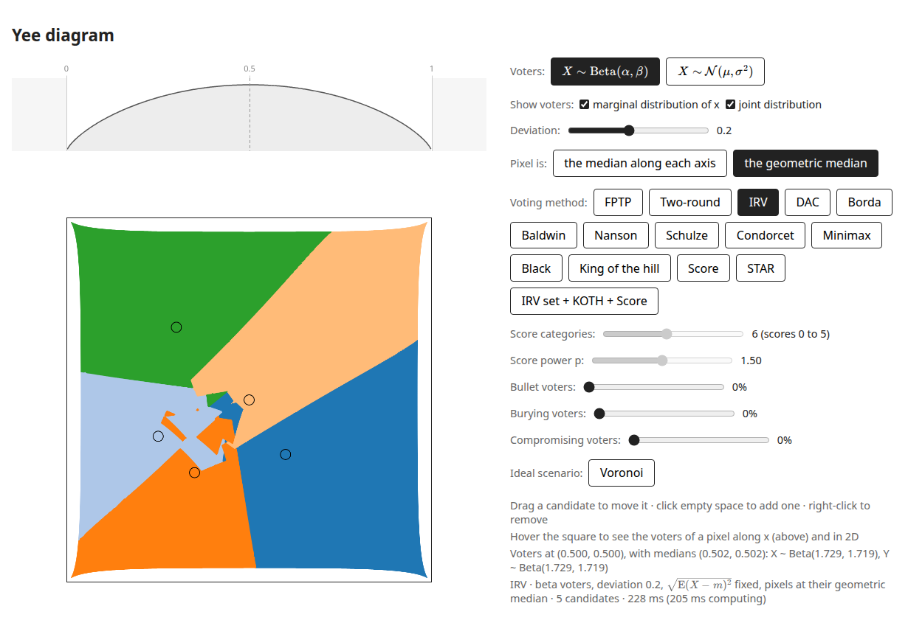

# YeeLab

A Yee diagram compares voting methods. Candidates are fixed points $c_1, \dots, c_C$ in the unit square $[0,1]^2$. The square is split into $n \times n$ pixels, and every pixel is its own election:

- the voters of the pixel are spread around the pixel centre $m$,
- every voter ranks the candidates by distance (closest first),
- the pixel is coloured by the winner of that election.



## What is different here

In the original Yee diagram the voters of a pixel are normal, $\mathcal{N}(m, \sigma^2 I)$, so some of them end up outside the square. Here each coordinate is Beta distributed instead, so every voter stays inside the square:

$$X \sim \text{Beta}(a, b), \qquad Y \sim \text{Beta}(a', b'), \qquad X, Y \text{ independent.}$$

$(a, b)$ are chosen per pixel so that

1. the pixel centre is the **median**: $F(m; a, b) = \tfrac12$,
2. the spread is the same for every pixel: $\sqrt{\mathbb{E}(X - m)^2}$ equals its value at the centre pixel, where $\mathbb{E}|X - \tfrac12| = D$.

$D$ is the model's deviation parameter and the *Deviation* slider of the UI (default $0.2$).

Why it matters: with normal voters every Condorcet method draws exactly the Voronoi diagram of the candidates. With Beta voters the median is a median only along the axes, so the skew of the distribution decides diagonal head-to-head races. Condorcet regions get pulled towards the centre and Condorcet cycles appear.

Voting methods: FPTP, IRV, Borda, Schulze, and `condorcet`, which marks pixels without a Condorcet winner in black. Baldwin, Nanson, Minimax, Black (the Condorcet winner, otherwise Borda) and approval voting are in the web UI only, where every method is [built from blocks](#methods-from-blocks). How the ranking probabilities are computed (exactly, without sampling voters) is described in [docs/math.pdf](docs/math.pdf).

## Running it

Requires [uv](https://docs.astral.sh/uv/).

### Documentation figures

[docs/figures.py](docs/figures.py) regenerates the figures of [docs/math.pdf](docs/math.pdf)
as PNG. Yee diagrams are drawn from the same margin-traced regions as the web UI:

```sh
uv run python docs/figures.py
```

To export an individual diagram independently as PNG (the default) or SVG:

```sh
uv run python -m yeelab.plot --method irv
uv run python -m yeelab.plot --method irv --format svg --output irv.svg
```

Pass `--svg` as a short form of `--format svg`. The default output is `irv.png`;
`--output` chooses a different path.

### Web UI

```sh
uv run fastapi dev
```

Then open http://127.0.0.1:8000. [yeelab/web/app.py](src/yeelab/web/app.py) serves the page in [yeelab/web/ui/index.html](src/yeelab/web/ui/index.html) and computes the diagrams. The diagram is drawn as curves, not pixels: the backend returns the region of every winner as polygons (`POST /api/regions`). It computes only the shares the method needs, caches everything a drag does not change, runs the hot loops as compiled [numba](https://numba.pydata.org/) kernels, and traces each border as the zero set of the winner's margin. The details are in the last chapter of [docs/math.pdf](docs/math.pdf). The very first start compiles the kernels, which takes a few seconds; numba caches them afterwards.

- **Candidates:** drag one to move it, click empty space to add one (up to 8), right-click to remove one. The diagram follows the drag, typically within 5–40 ms; IRV with 8 candidates, which needs every ranking cell, within about 0.1–0.2 s.
- **Method:** Voronoi (no voters, the reference), FPTP, Two-round, IRV, DAC (descending acquiescing coalitions), Borda, Baldwin, Nanson, Schulze, Condorcet, Minimax, Black, King of the hill, Score, STAR or IRV set + KOTH + Score. The tooltip of a method says what it does and which blocks it is built from.
- **Score categories** and **Score power p** (Score and STAR): the number of scores on a ballot, 2 (approval) to 11, and how sparingly the top scores are given, $p$ from 1 (in proportion to the distance) to 2, by default 1.5.
- **Runoff tie weight** (STAR and other methods using score comparisons): how much a voter who gave two runoff candidates the same score counts by their ordinal preference, from 0 (STAR abstention, the default) to 1 (ordinary pairwise runoff).
- **Bullet voters**, **Burying voters** and **Compromising voters:** the share of the voters who vote strategically, all 0 (every voter sincere) at first ([docs/math.pdf](docs/math.pdf), chapter "Strategic voting"). The frontrunners are the two candidates with the most first choices.
  - **Bullet voters** rank their first choice first and all other candidates equal below it.
  - **Burying voters**, a share of the others, rank last the frontrunner they like less (on a score ballot: 0).
  - **Compromising voters**, a share of the others, rank first the frontrunner they like more if neither is their first choice (on a score ballot: the top score). Some voters bury and compromise both.
- **Voters:** Beta, or normal for the original Yee model.
- **Deviation:** $D$ from $0.05$ to $0.4$.
- **Hover** over the square to see the voters of that pixel: their 2D density over the square and their distribution along $x$ above it.

Or in Docker, without uv:

```sh
docker build -t yee-lab .
docker run -p 8000:8000 yee-lab
```

## Code

The code is the package `yeelab` in [src/yeelab/](src/yeelab/). There is one calculation path:

- `yeelab/margin/` computes only the shares each method needs, gives the winner with a margin that is 0 on every border, and traces the regions as polygons. Its methods are built from blocks in `yeelab/build/` (below).
- [docs/figures.py](docs/figures.py) uses the same regions for diagrams and exports them as PNG/SVG. The tests check the region geometry and its underlying shares against analytical and Monte Carlo references.

The voter distributions and ranking cells are defined in `ranking_cells.py` and `normal.py`; `voting.py` supplies shared IRV-round and Condorcet-cycle logic. `yeelab/web/` is the FastAPI app and page, on top of `margin/`.

`uv run pytest` runs the tests (GitHub Actions runs them on every push and pull request, and builds the Docker image); `uv run python docs/figures.py` regenerates the figures of [docs/math.pdf](docs/math.pdf) as PNG.
Yee diagrams in these figures are drawn from the margin-traced regions; the tests validate
shares against analytical and Monte Carlo references.

### Methods from blocks

[yeelab/build/](src/yeelab/build/) puts a voting method together from small blocks, like Scratch does, but with plain Python constructors:

```python
from yeelab.build import Tally, BordaCount, Plurality, Highest, Eliminate
from yeelab.build import Pairwise, Margins, StrongestPaths, Weakest, Unbeaten, Conditional

borda   = Highest(Tally(BordaCount()))
fptp    = Highest(Tally(Plurality()))
irv     = Eliminate(Tally(Plurality()), how="min")
baldwin = Eliminate(Tally(BordaCount()), how="min")
nanson  = Eliminate(Tally(BordaCount()), how="mean")

margins = Margins(Pairwise())
schulze = Unbeaten(StrongestPaths(margins))
condorcet = Unbeaten(margins)
minimax = Highest(Weakest(margins))
black   = Conditional(condorcet, when_true=condorcet, when_false=borda)
two_round = Unbeaten(margins, among=Highest(Tally(Plurality()), n=2))

from yeelab.build import Score, ScoreComparisons

ballot  = Score(6, power=1.5)                   # scores 0 to 5 by the part of the way to the power 1.5
score   = Highest(Tally(ballot))
star    = Unbeaten(ScoreComparisons(ballot), among=Highest(Tally(ballot), n=2))

# Conditions compare method results for each election; combine them with & or |
finalists = Conditional(
    (fptp == two_round) & (two_round != condorcet),
    when_true=score | condorcet,
    when_false=score | two_round,
)
star_finalists = Unbeaten(ScoreComparisons(ballot), among=finalists)

from yeelab.build import Bullet, Burial, Compromise

Bullet(borda, share=0.3)                  # Borda where 30% of the voters bullet vote
Burial(borda, share=0.3)                  # Borda where 30% of the voters bury a frontrunner
Compromise(fptp, share=0.3)               # FPTP where 30% of the voters compromise on a frontrunner
Bullet(Burial(Compromise(borda, share=0.4), share=0.2), share=0.3)  
# 30% bullet vote; of the others 20% bury, 40% compromise
```

A **ballot** gives each candidate points, [`Tally`](src/yeelab/build/blocks.py#L639) averages them over the voters of a pixel, and a **winner** block ([`Highest`](src/yeelab/build/blocks.py#L866), [`Eliminate`](src/yeelab/build/blocks.py#L739), [`Unbeaten`](src/yeelab/build/blocks.py#L967), [`Conditional`](src/yeelab/build/blocks.py)) picks the winner. **Condorcet methods** start from [`Pairwise()`](src/yeelab/build/blocks.py#L513). [`Score`](src/yeelab/build/blocks.py#L298) ballots give scores from 0 to `levels - 1` by distance; `power` sets how sparingly the top scores are given. A block checks its input when it is built, and `repr` gives back the expression.

`method.evaluate(voters)` returns the **winner** and the **margin**. Each method computes only the shares it needs; the details are in [docs/math.pdf](docs/math.pdf).

## License

[MIT](LICENSE). The bundled [KaTeX](src/yeelab/web/ui/vendor/katex/LICENSE) and [uPlot](src/yeelab/web/ui/vendor/uplot/LICENSE) are MIT too.
